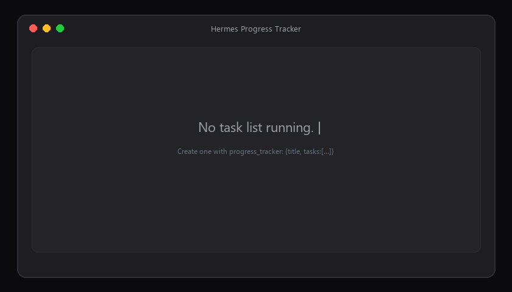
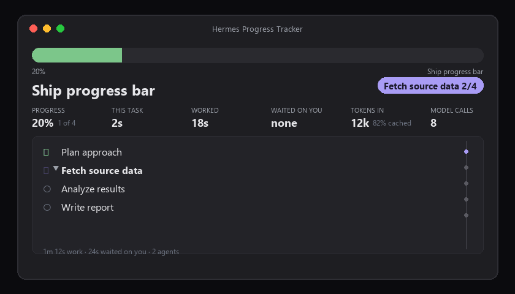
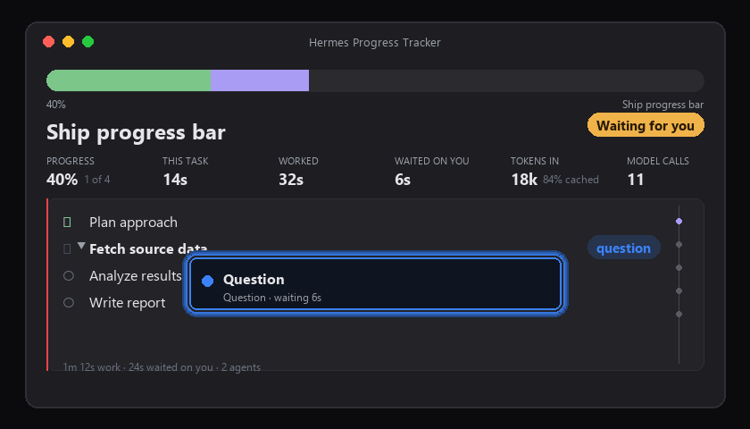
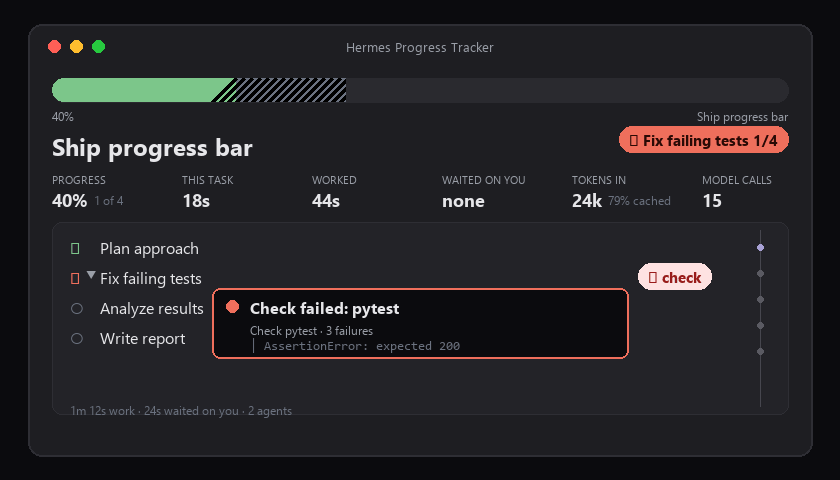

# Hermes Progress Tracker

> Hermes fork/port of [mjoyshuvo/claude-progress-tracker](https://github.com/mjoyshuvo/claude-progress-tracker) — originally a Claude Code hooks plugin, adapted to run on Hermes Agent.

A [Hermes Agent](https://hermes-agent.nousresearch.com/) desktop plugin that shows real progress bars for agent work: goal-level tasks, permission/question blocks, findings, token/context usage, and work-vs-wait timing.


---

## Features

- Per-session task bar: create with goal-level steps, advance, skip, mark failed/fixed, add steps later.
- Blocks timeline: permission requests, human-input questions, and tool rows.
- Findings log with capped history.
- Token/context tiles from model calls.
- Work vs waited-on-you timing. Wait only counts open permission/question blocks — tool calls are work, not waiting.
- Session-scoped: each conversation has its own bar; when a session ends only its unfinished bar is dismissed — a completed bar stays visible until the next task replaces it.
- Desktop pane plus an above-the-composer band.

## Requirements

Hermes >= 0.22 (see `requires_hermes` in `plugin.yaml`).

## Install

1. Copy this directory to `$HERMES_HOME/plugins/progress-tracker`.
2. Run `hermes plugins enable progress-tracker`.
3. Restart the gateway.
4. In Capabilities -> Plugins, enable **Progress Tracker**, then run "Reload desktop plugins".

## Install by asking Hermes

Paste this into Hermes:

```text
Install the Hermes Progress Tracker plugin from https://github.com/mariogoncalves2903-debug/hermes-progress-tracker: clone it into $HERMES_HOME/plugins/progress-tracker, run `hermes plugins enable progress-tracker`, restart the gateway, then enable Progress Tracker in Capabilities -> Plugins and reload desktop plugins.
```

## Tool

The agent drives the bar through the `progress_tracker` tool:

| op | args | effect |
|---|---|---|
| `title` | `title`, `tasks` | create a bar with goal-level steps |
| `tasks` | `tasks` | replace the task list |
| `add` | `tasks` | append steps |
| `next` | - | advance to the next step |
| `active` | `task` | set a named step active |
| `skip` | `task` | skip a named step |
| `failed` | `text` | mark the active step failed |
| `fixed` | - | clear failure state |
| `found` | `text` | log a finding |
| `dismiss` | - | dismiss the bar |

Use goal-level steps from the user's request, never raw tool names.

## Configuration

See `plugin.yaml`: `enabled_tools`, `enabled_findings`, `max_findings`, `max_turns_retained`.

## Tests

```bash
cd tests
python -m unittest discover -s . -v
```

## License

MIT — see [LICENSE](LICENSE).

---

## All States

| State | Preview |
|-------|---------|
| **Idle** — no task list running |  |
| **Working** — tasks in progress, bar fills as steps complete |  |
| **Waiting (permission)** — blocked on a file-edit permission prompt |  |
| **Waiting (question)** — blocked on a human question |  |
| **Waiting (approval)** — blocked on plan approval |  |
| **Failed** — a step hit an error, findings logged |  |
| **Skipped** — a step was skipped, work continues |  |
| **Done** — all steps complete; stays visible until the next task |  |
| **Log view** — permission blocks, answered items, findings |  |
