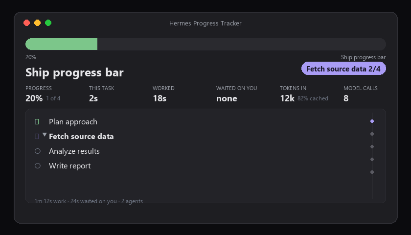
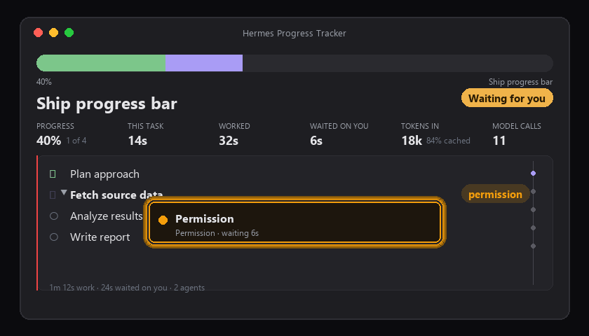
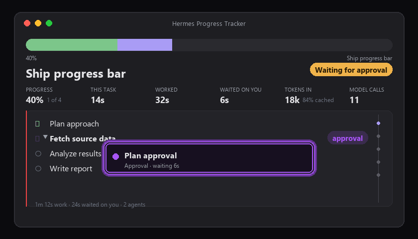
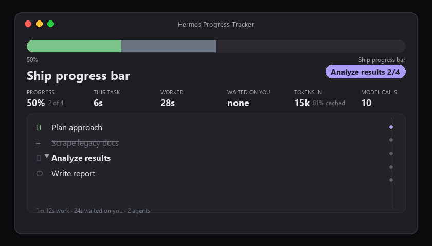
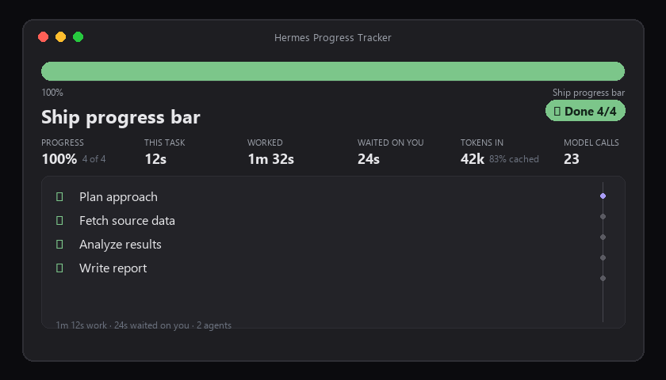
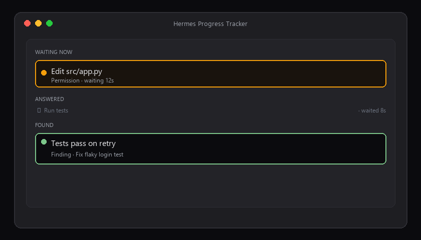

# Hermes Progress Tracker

[](plugin.yaml)
[](LICENSE)
[](https://github.com/mjoyshuvo/claude-progress-tracker)

Hermes Progress Tracker is a [Hermes Agent](https://hermes-agent.nousresearch.com/) plugin that shows what the agent is doing while it works. It draws a live progress bar above the composer, and it adds a Progress pane that lists what waits on you and what the agent found.

It is a port of [mjoyshuvo/claude-progress-tracker](https://github.com/mjoyshuvo/claude-progress-tracker), originally a Claude Code hooks plugin, adapted to the Hermes plugin API.



## Features

- **Live bar.** Each goal-level task list gets a row with a moving bar. The pill names the current task and its step, for example `Build harness 2/5`.
- **Real totals.** A declared task list shows `3/5` and a percent. No total is invented when the list is absent.
- **Standing rule.** Any request that can be decomposed is broken into goal-level steps and tracked automatically.
- **Enforcement.** Once a request looks like project work, heavy tools are blocked until a real bar exists. Explanatory questions and trivial one-shot actions stay untracked.
- **Waits on you.** A question, permission prompt, or approval turns the row amber and appears in the Progress pane.
- **Failing checks.** A failing step turns the row red, logs the reason, and keeps a failure count.
- **Findings log.** Root causes, decisions, and failures stay in the pane with capped history.
- **Measured numbers.** Work time excludes time spent waiting on you; token and context tiles come from model calls.
- **Session-scoped rows.** Each conversation has its own bar. Ending a session dismisses only its unfinished bar; a completed bar stays visible until the next task replaces it.
- **Desktop pane plus band.** The bar sits above the composer; `/progress` opens the details pane.

## Install

Hermes >= 0.22 is required (see `requires_hermes` in `plugin.yaml`).

```bash
hermes plugins install mariogoncalves2903-debug/hermes-progress-tracker --enable
```

Then restart the gateway and enable **Progress Tracker** in Capabilities → Plugins → Reload desktop plugins.

To install it by asking Hermes, paste this:

```text
Install the Hermes Progress Tracker plugin from https://github.com/mariogoncalves2903-debug/hermes-progress-tracker using `hermes plugins install`, enable it, restart the gateway, then enable Progress Tracker in Capabilities → Plugins and reload desktop plugins.
```

## Updates

The installer tracks this repo as a Git install. Updates arrive automatically when `plugins.auto_apply` is on:

```bash
hermes plugins auto-update on
```

The gateway checks for updates every 24 hours by default (configurable via `plugins.auto_update_check_hours`). Updated code loads in new sessions.

To check and apply manually:

```bash
hermes plugins check-updates        # see what changed
hermes plugins update progress-tracker   # pull the latest
```

## Read the bar

Each task list gets one row. A row has a label, the bar, its numbers, and the state colour.

| Colour | State | Pill text |
| --- | --- | --- |
| Purple | The agent is working. | `Build 2/5` or `Working · 12 steps` |
| Red | A step failed in the current task. | `✕ Verify 1/2` or `✕ Test 3/5 ×3` |
| Amber | The agent waits for you. | `Waiting for you` or `Waiting for approval` |
| Green | Every task is done. | `✓ Done 5/5` |

The row shows measured values only: progress, time worked, time waited on you, tokens in/out, model calls, and context fill. It does not guess time remaining.

A finished row stays visible until the next task replaces it. Starting a new session drops stale unfinished and hidden rows; completed rows remain until replaced.

## Use the enforcement rule

The plugin adds a short system-prompt rule: if a request can be broken into steps, the agent breaks it down and tracks it. Prompt guidance alone is not enough, so the hook layer enforces it narrowly.

Once a request looks like project work, heavy tools are blocked until a real bar exists:

- `terminal`, `execute_code`, `write_file`, `patch`
- `browser_exec`, `computer_use`
- `delegate_task`, `tool_call`

The detector looks for build-shaped language (`build`, `create`, `implement`, `harness`, `fix`, `deploy`, and similar) plus request phrasing. It ignores explanatory openers such as “explain how to…”, and it leaves trivial one-shot chatter untracked. A successful `progress_tracker` call clears the project hint, so later unrelated commands in the same session are not blocked forever.

## The `progress_tracker` tool

The agent drives the bar through `progress_tracker`:

| op | args | effect |
| --- | --- | --- |
| `title` | `title`, `tasks` | Create a bar with goal-level steps. |
| `tasks` | `tasks` | Replace the task list. |
| `add` | `tasks` | Append steps found during the work. |
| `next` | - | Finish the current task and start the next one. |
| `active` | `task` | Make the named step active; part of the name is enough. |
| `skip` | `task` | Close the current task as not needed. |
| `failed` | `reason` | Mark the active step failed with this reason. |
| `fixed` | - | Clear the failure state. |
| `found` | `text` | Log a finding to the Progress pane. Works without a bar. |
| `dismiss` | - | Dismiss the bar. |

Use goal-level steps from the user's request, never raw tool names. If the agent names a task that does not exist, the tool refuses the call and lists the task names.

## Configuration

See `plugin.yaml`: `enabled_tools`, `enabled_findings`, `max_findings`, `max_turns_retained`.

## Test

From the plugin folder:

```bash
python -m unittest discover -s tests -v
```

To check the manifest and hooks the way Hermes loads them:

```bash
hermes plugins doctor progress-tracker
```

## Project layout

| Path | Contents |
| --- | --- |
| `__init__.py` | Plugin registration, hooks, enforcement gate, and the `progress_tracker` tool. |
| `progress_store.py` | State store: rows, tasks, blocks, findings, turns, and pruning. |
| `desktop/plugin.js` | Desktop renderer for the band and Progress pane. |
| `desktop/plugin.css` | Styling for the band and pane. |
| `plugin.yaml` | Manifest, hook declarations, and config schema. |
| `tests/` | Unit tests for the store and hooks. |
| `assets/states/` | Animated state previews. |

## Known limits

- Only the main conversation is tracked. Sub-agent task calls do not feed the parent bar.
- Work time and tokens count from when the plugin loaded. A row open before a reload shows only post-reload activity.
- Enforcement judges request shape, not intent. It is deliberately conservative: some short project requests may pass untracked, and some research inside a tracked task is allowed once a bar exists.
- Read-only research tools (`read_file`, `search_files`, `web_search`) are not gated; the gate targets side-effecting and meta-tools.
- The timeline colours are tuned for the dark theme.

## License

MIT — see [LICENSE](LICENSE).

---

## All States

| State | Preview |
|-------|---------|
| **Idle** — no task list running |  |
| **Working** — tasks in progress, bar fills as steps complete |  |
| **Waiting (permission)** — blocked on a file-edit permission prompt |  |
| **Waiting (question)** — blocked on a human question |  |
| **Waiting (approval)** — blocked on plan approval |  |
| **Failed** — a step hit an error, findings logged |  |
| **Skipped** — a step was skipped, work continues |  |
| **Done** — all steps complete; stays visible until the next task |  |
| **Log view** — permission blocks, answered items, findings |  |
